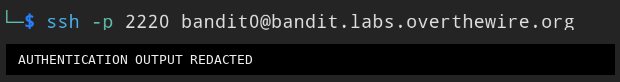
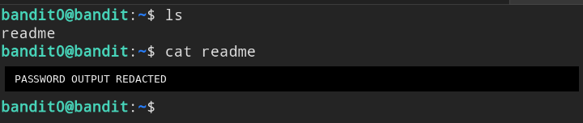

# Level 0 — SSH setup and the first file

**Session:** `bandit0` → `bandit1` · [Official setup](https://overthewire.org/wargames/bandit/bandit0.html) · [Official challenge](https://overthewire.org/wargames/bandit/bandit1.html)

## Connect

Run this in your local terminal with an SSH client installed:

```bash
ssh -p 2220 bandit0@bandit.labs.overthewire.org
```

`-p 2220` selects Bandit's SSH port; `bandit0` is the account. Use the initial password from the official setup page. The password prompt does not display what you type.

On a first connection, SSH asks about the server's host key. Verify that you are connecting to the intended host before accepting it.



## Commands I used

In the remote `bandit0` home directory:

```bash
ls
cat readme
```

| Command | Simple explanation |
| --- | --- |
| `ls` | List files in the current directory. |
| `cat readme` | Print `readme`, which contains the password for `bandit1`. |



## Backup

```bash
cat < readme
```

The shell opens `readme` as standard input, and `cat` prints it. This reads the same contents.

## Continue

Save the recovered password privately. Return to your local terminal with any of these options, tested in a Bandit SSH login shell:

| Option | How to use it |
| --- | --- |
| `exit` | Type the command and press Enter to end the remote shell. |
| `logout` | Type the command and press Enter in the SSH login shell. |
| `Ctrl+D` | Press at an empty shell prompt to end the remote shell. |

Then connect from your local terminal:

```bash
ssh -p 2220 bandit1@bandit.labs.overthewire.org
```

Enter the password at the prompt. [Back to the index](../README.md)
