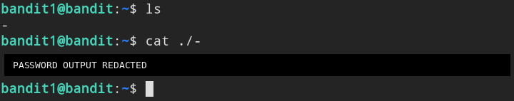

# Level 1 — Reading a file named `-`

**Session:** `bandit1` → `bandit2` · [Official challenge](https://overthewire.org/wargames/bandit/bandit2.html)

## Level goal

From the [official challenge page](https://overthewire.org/wargames/bandit/bandit2.html):

> The password for the next level is stored in a file called **-** located in the home directory

Start in the remote `bandit1` home directory, using the password you recovered in Level 0.

## Commands I used

```bash
ls
cat ./-
```

| Command | Simple explanation |
| --- | --- |
| `ls` | List the files, including the one named `-`. |
| `cat ./-` | Open the file named `-` in the current directory and print its contents. |

`./` means the current directory. A bare `cat -` reads standard input, so it waits for keyboard input instead of opening the file.



## Backup

```bash
cat < -
```

The shell opens the file named `-` and sends its contents to `cat` through standard input. Quoting `"-"` or using `cat -- -` still leaves `cat` with its special standard-input operand.

## Continue

Save the password privately. Return to your local terminal with any of these options, tested in a Bandit SSH login shell:

| Option | How to use it |
| --- | --- |
| `exit` | Type the command and press Enter to end the remote shell. |
| `logout` | Type the command and press Enter in the SSH login shell. |
| `Ctrl+D` | Press at an empty shell prompt to end the remote shell. |

Then connect from your local terminal:

```bash
ssh -p 2220 bandit2@bandit.labs.overthewire.org
```

Enter the recovered password at the prompt. [Back to the index](../README.md)
