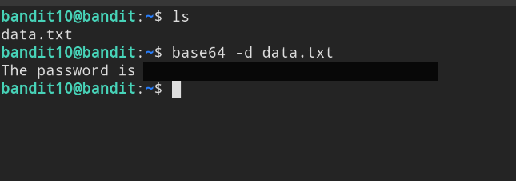

# Level 10 — Decoding Base64

**Session:** `bandit10` → `bandit11` · [Official challenge](https://overthewire.org/wargames/bandit/bandit11.html)

## Level goal

From the [official challenge page](https://overthewire.org/wargames/bandit/bandit11.html):

> The password for the next level is stored in the file **data.txt**, which contains base64 encoded data

## Commands I used

In the remote `bandit10` home directory:

```bash
ls
base64 -d data.txt
```

| Command | Simple explanation |
| --- | --- |
| `ls` | Locate the encoded file. |
| `base64 -d data.txt` | Decode the Base64 data and print the original text. |

The decoded sentence contains the password for `bandit11`. Base64 is an encoding: it represents data as printable characters and does not provide encryption.



## Backup

```bash
openssl base64 -d -in data.txt
```

OpenSSL can also decode Base64. `-d` selects decoding and `-in` names the input file.

## Use case

Decode Base64 when inspecting encoded attachments, configuration values, or text representations of binary data. OpenSSL is useful for both encoding tasks and the TLS challenges later in these writeups.

## Continue

Save the recovered password privately. Return to your local terminal using `exit`, `logout` in the SSH login shell, or `Ctrl+D` at an empty prompt. Then connect:

```bash
ssh -p 2220 bandit11@bandit.labs.overthewire.org
```

Enter the recovered password at the prompt. [Back to the index](../README.md)
