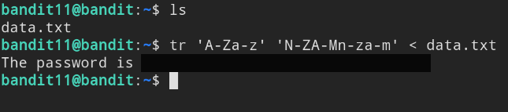

# Level 11 — Reversing ROT13

**Session:** `bandit11` → `bandit12` · [Official challenge](https://overthewire.org/wargames/bandit/bandit12.html)

## Level goal

From the [official challenge page](https://overthewire.org/wargames/bandit/bandit12.html):

> The password for the next level is stored in the file **data.txt**, where all lowercase (a-z) and uppercase (A-Z) letters have been rotated by 13 positions

## Commands I used

In the remote `bandit11` home directory:

```bash
ls
tr 'A-Za-z' 'N-ZA-Mn-za-m' < data.txt
```

| Part | Simple explanation |
| --- | --- |
| `tr` | Translate characters from the first set to the second. |
| `'A-Za-z'` | Select uppercase and lowercase letters. |
| `'N-ZA-Mn-za-m'` | Shift each alphabet by 13 places, wrapping at the end. |
| `< data.txt` | Read the file through standard input. |

ROT13 is its own inverse: applying the same shift again restores the original letters. Case is preserved; spaces, digits, and punctuation are unchanged.



## Backup

If Python 3 is available:

```bash
python3 -c 'import codecs; print(codecs.decode(open("data.txt").read(), "rot_13"), end="")'
```

Python's `rot_13` codec applies the same translation and prints the decoded text without adding an extra newline.

## Use case

Use `tr` for simple character substitutions. ROT13 can obscure puzzle text, but it does not protect secrets.

## Continue

Save the recovered password privately. Return to your local terminal using `exit`, `logout` in the SSH login shell, or `Ctrl+D` at an empty prompt. Then connect:

```bash
ssh -p 2220 bandit12@bandit.labs.overthewire.org
```

Enter the recovered password at the prompt. [Back to the index](../README.md)
