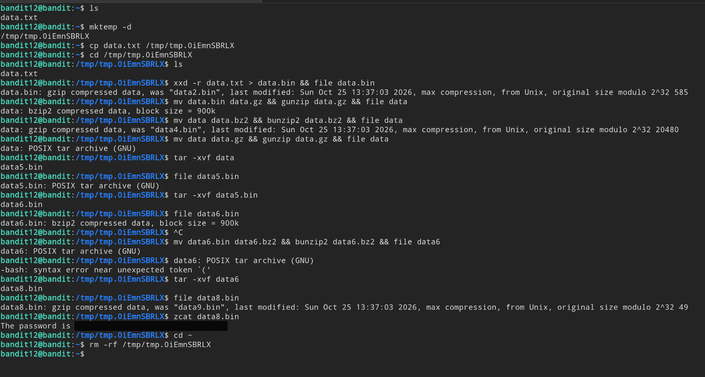

# Level 12 — Unpacking a hexdump and compression layers

**Session:** `bandit12` → `bandit13` · [Official challenge](https://overthewire.org/wargames/bandit/bandit13.html)

## Level goal

From the [official challenge page](https://overthewire.org/wargames/bandit/bandit13.html):

> The password for the next level is stored in the file **data.txt**, which is a hexdump of a file that has been repeatedly compressed. For this level it may be useful to create a directory under /tmp in which you can work. Use mkdir with a hard to guess directory name. Or better, use the command “mktemp -d”. Then copy the datafile using cp, and rename it using mv (read the manpages!)

## Commands I used

In the remote `bandit12` home directory, create a workspace and copy the input. The screenshot copies the generated directory name manually; here I store it in `workdir` so the commands use your own result.

```bash
ls
workdir=$(mktemp -d)
cp data.txt "$workdir"
cd "$workdir"
ls
xxd -r data.txt > data.bin && file data.bin
mv data.bin data.gz && gunzip data.gz && file data
mv data data.bz2 && bunzip2 data.bz2 && file data
mv data data.gz && gunzip data.gz && file data
tar -xvf data
file data5.bin
tar -xvf data5.bin
file data6.bin
mv data6.bin data6.bz2 && bunzip2 data6.bz2 && file data6
tar -xvf data6
file data8.bin
```

| Command or part | Simple explanation |
| --- | --- |
| `mktemp -d` | Create a new directory with a generated name. |
| `cp` / `cd` | Copy the input into that directory and work there. |
| `xxd -r` | Reverse the hexdump into binary data. |
| `> data.bin` | Write that binary data to a file. |
| `&&` | Run the next command only if the preceding one succeeds. |
| `file` | Identify the next layer from its contents. |
| `mv` | Rename a file to the extension expected by the decompressor. |
| `gunzip` / `bunzip2` | Unpack gzip / bzip2 data. |
| `tar -xvf` | Extract a tar archive; `v` lists members and `f` names the archive. |

The identified layers are gzip → bzip2 → gzip → tar → tar → bzip2 → tar → gzip → text. Repeat “identify, unpack, identify” instead of guessing from the filename.

The screenshot skips the final decompression command. I confirmed that omission; complete the last gzip layer before reading the text:

```bash
mv data8.bin data8.gz && gunzip data8.gz && cat data8
```

`cat data8.bin` cannot decode a file that is still gzip-compressed. The distinct name `data8.gz` also avoids overwriting the earlier `data` archive. The screenshot includes an accidentally pasted `file` description; its syntax error is not part of the solution.



## Backup

For this confirmed sequence of single-file archives, stream each layer without renaming files:

```bash
xxd -r data.txt |
  gzip -dc |
  bzip2 -dc |
  gzip -dc |
  tar -xOf - |
  tar -xOf - |
  bzip2 -dc |
  tar -xOf - |
  gzip -dc
```

`-dc` decompresses to standard output. `tar -xOf -` reads an archive from standard input and writes its member contents to standard output. This pipeline depends on the layer order above; inspect your own file if it differs.

## Use case

Use file signatures and matching decompressors when recovering data wrapped in several archive or compression formats.

## Continue

Save the recovered password privately. Return to your local terminal using `exit`, `logout` in the SSH login shell, or `Ctrl+D` at an empty prompt. Then connect:

```bash
ssh -p 2220 bandit13@bandit.labs.overthewire.org
```

Enter the recovered password at the prompt. [Back to the index](../README.md)
