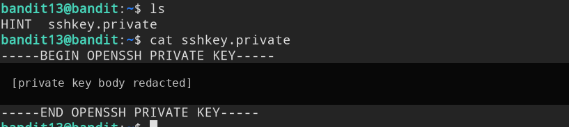
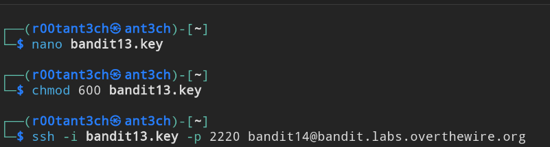
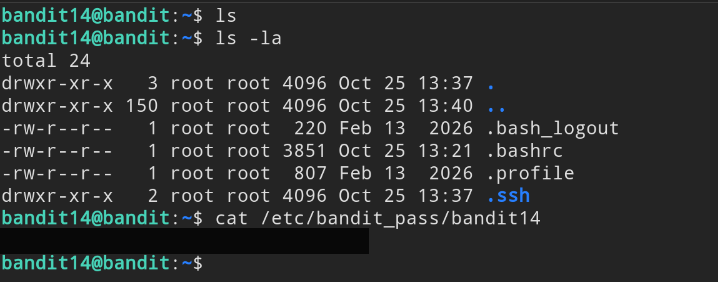

# Level 13 — Network work begins — SSH key authentication

**Session:** `bandit13` → `bandit14` · [Official challenge](https://overthewire.org/wargames/bandit/bandit14.html)

## Level goal

From the [official challenge page](https://overthewire.org/wargames/bandit/bandit14.html):

> The password for the next level is stored in **/etc/bandit_pass/bandit14 and can only be read by user bandit14**. For this level, you don’t get the next password, but you get a private SSH key that can be used to log into the next level. Look at the commands that logged you into previous bandit levels, and find out how to use the key for this level. If you need help with this level: a hint file can be found in the home directory. Make sure to read the error messages as they are informative.

## Commands I used

**Network focus starts here:** SSH key authentication replaces the next password as the way into `bandit14`. Later challenges build on this with TCP, TLS, port discovery, and listeners.

### 1. Read the key on Bandit

In the remote `bandit13` home directory:

```bash
ls
cat sshkey.private
```

| Command | Simple explanation |
| --- | --- |
| `ls` | Find `sshkey.private` and the hint file. |
| `cat sshkey.private` | Display the private key used to authenticate as `bandit14`. |



### 2. Save it locally and log in

Return to your local terminal. Paste the complete key, including its BEGIN/END lines, into the file opened by `nano`, then save and close the editor:

```bash
nano bandit13.key
chmod 600 bandit13.key
ssh -i bandit13.key -p 2220 bandit14@bandit.labs.overthewire.org
```

| Command or part | Simple explanation |
| --- | --- |
| `nano bandit13.key` | Save a private local copy of the key. |
| `chmod 600` | Allow only your user to read and write that file. |
| `ssh -i bandit13.key` | Use this identity file for authentication. |
| `-p 2220` | Connect to Bandit's SSH port. |
| `bandit14@…` | Log in as the account allowed to read the next password file. |

The local filename is `bandit13.key` in my session; the account it unlocks is `bandit14`.



### 3. Read the password as bandit14

In the new remote `bandit14` shell:

```bash
ls
ls -la
cat /etc/bandit_pass/bandit14
```

The absolute path comes from the official goal. This is the current `bandit14` password, needed for the next challenge.



## Backup

Copy the key over SSH instead of pasting it. Run these in your local terminal:

```bash
scp -P 2220 bandit13@bandit.labs.overthewire.org:sshkey.private ./bandit13.key
chmod 600 bandit13.key
ssh -i bandit13.key -p 2220 bandit14@bandit.labs.overthewire.org
```

Authenticate the copy as `bandit13`, then read `/etc/bandit_pass/bandit14` after the key login. `scp` uses uppercase `-P` for its port; `ssh` uses lowercase `-p`.

## Use case

SSH keys let you authenticate to remote accounts without sending that account's login password. `ssh -i` selects the key and `chmod 600` protects the local copy.

## Continue

You are already logged in as `bandit14` after the key login above. Save the recovered password privately for the next challenge. [Back to the index](../README.md)
