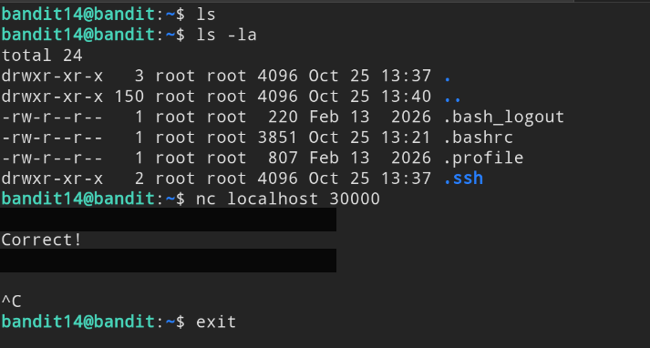

# Level 14 — Submitting a password over TCP

**Session:** `bandit14` → `bandit15` · [Official challenge](https://overthewire.org/wargames/bandit/bandit15.html)

## Level goal

From the [official challenge page](https://overthewire.org/wargames/bandit/bandit15.html):

> The password for the next level can be retrieved by submitting the password of the current level to **port 30000 on localhost**.

## Commands I used

Run the service connection inside the remote `bandit14` shell. Here, `localhost` means the Bandit server.

```bash
ls
ls -la
nc localhost 30000
```

After connecting, enter the current `bandit14` password and press Enter. The service replies `Correct!` followed by the password for `bandit15`.

| Command or action | Simple explanation |
| --- | --- |
| `ls` / `ls -la` | Inspect the home directory. |
| `nc localhost 30000` | Open a plain TCP connection to the local service on port 30000. |
| Password + Enter | Send the current password as a newline-terminated line. |
| `Ctrl+C` | Stop `nc` after saving the reply, if it remains open. |



## Backup

Send the current password directly from its file:

```bash
nc localhost 30000 < /etc/bandit_pass/bandit14
```

Input redirection supplies the same line without typing it into `nc`. Stop the client after receiving the response if the connection stays open.

## Use case

`nc` is useful for talking to simple TCP services and checking how a line-based protocol responds.

## Continue

Save the recovered password privately. Return to your local terminal using `exit`, `logout` in the SSH login shell, or `Ctrl+D` at an empty prompt. Then connect:

```bash
ssh -p 2220 bandit15@bandit.labs.overthewire.org
```

Enter the recovered password at the prompt. [Back to the index](../README.md)
