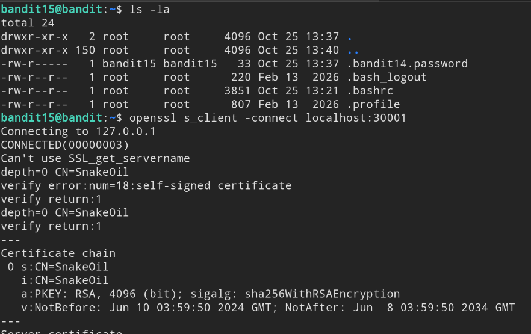
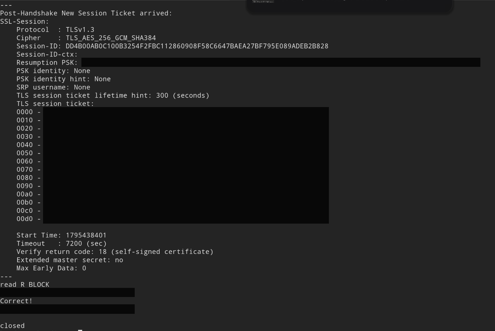

# Level 15 — Submitting a password over TLS

**Session:** `bandit15` → `bandit16` · [Official challenge](https://overthewire.org/wargames/bandit/bandit16.html)

## Level goal

From the [official challenge page](https://overthewire.org/wargames/bandit/bandit16.html):

> The password for the next level can be retrieved by submitting the password of the current level to **port 30001 on localhost** using SSL/TLS encryption.
>
> **Helpful note: Getting “DONE”, “RENEGOTIATING” or “KEYUPDATE”? Read the “CONNECTED COMMANDS” section in the manpage.**

## Commands I used

In the remote `bandit15` shell:

```bash
ls -la
openssl s_client -connect localhost:30001
```

| Part | Simple explanation |
| --- | --- |
| `openssl s_client` | Start a TLS client for inspecting and communicating with a TLS service. |
| `-connect localhost:30001` | Connect to port 30001 on the Bandit server. |
| Password + Enter | Send the current `bandit15` password after the TLS handshake. |

The first screenshot shows the handshake and a self-signed certificate warning. The lab connection proceeds, but that warning does not establish a trusted server identity.



The second screenshot shows TLS 1.3, the submitted line, `Correct!`, the new password, and connection closure. Save the password for `bandit16`.



## Backup

```bash
openssl s_client -connect localhost:30001 -quiet < /etc/bandit_pass/bandit15
```

`-quiet` suppresses session chatter and disables the interactive command-letter handling. The input file supplies the current password. Certificate diagnostics can still appear.

If a normal interactive session prints `DONE`, `RENEGOTIATING`, or `KEYUPDATE`, follow the official goal's note about connected commands; use `-quiet` for the password exchange.

## Use case

Use `openssl s_client` to inspect TLS handshakes, certificates, protocol versions, and service responses. A plain `nc` connection does not perform this TLS handshake.

## Continue

Save the recovered password privately. Return to your local terminal using `exit`, `logout` in the SSH login shell, or `Ctrl+D` at an empty prompt. Then connect:

```bash
ssh -p 2220 bandit16@bandit.labs.overthewire.org
```

Enter the recovered password at the prompt. [Back to the index](../README.md)
