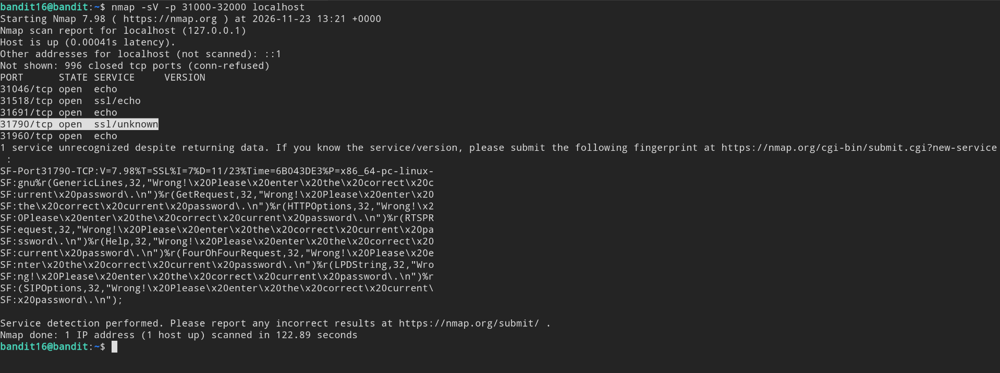
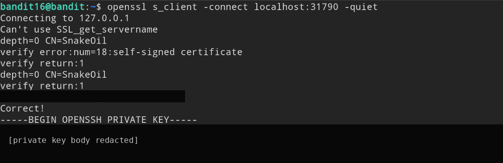
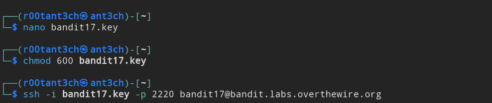

# Level 16 — Finding the TLS service and receiving an SSH key

**Session:** `bandit16` → `bandit17` · [Official challenge](https://overthewire.org/wargames/bandit/bandit17.html)

## Level goal

From the [official challenge page](https://overthewire.org/wargames/bandit/bandit17.html):

> The credentials for the next level can be retrieved by submitting the password of the current level to **a port on localhost in the range 31000 to 32000**. First find out which of these ports have a server listening on them. Then find out which of those speak SSL/TLS and which don’t. There is only 1 server that will give the next credentials, the others will simply send back to you whatever you send to it.
>
> **Helpful note: Getting “DONE”, “RENEGOTIATING” or “KEYUPDATE”? Read the “CONNECTED COMMANDS” section in the manpage.**

## Commands I used

### 1. Discover the services

In the remote `bandit16` shell:

```bash
nmap -sV -p 31000-32000 localhost
```

| Part | Simple explanation |
| --- | --- |
| `nmap` | Discover listening network services. |
| `-sV` | Probe open ports to identify their services, including TLS wrapping. |
| `-p 31000-32000` | Scan the exact range in the official question. |
| `localhost` | Scan the Bandit server from within the Bandit shell. |

| Port in my session | Service reported |
| --- | --- |
| 31046 | `echo` |
| 31518 | `ssl/echo` |
| 31691 | `echo` |
| 31790 | `ssl/unknown` |
| 31960 | `echo` |

An echo service returns what you sent. `ssl/unknown` means Nmap detected TLS but did not name the application; it does not itself prove that the service gives the key.



### 2. Submit the password to the matching TLS service

```bash
openssl s_client -connect localhost:31790 -quiet
```

Enter the current `bandit16` password and press Enter. In this session, port 31790 replies `Correct!` and returns an SSH private key. Use your own scan results if the ports differ. `-quiet` avoids treating password-leading letters as interactive OpenSSL commands.



### 3. Log in with the returned key

Return to your local terminal. Paste the complete returned key, including its BEGIN/END lines, into `bandit17.key`, then save it:

```bash
nano bandit17.key
chmod 600 bandit17.key
ssh -i bandit17.key -p 2220 bandit17@bandit.labs.overthewire.org
```

| Command or part | Simple explanation |
| --- | --- |
| `nano bandit17.key` | Save the returned credential locally. |
| `chmod 600` | Restrict access to that private key file. |
| `ssh -i bandit17.key` | Authenticate using the returned key. |
| `-p 2220` | Use Bandit's SSH port. |




## Backup

Use Netcat to find open ports, then test the open ports with a TLS client:

```bash
nc -zv -w 1 localhost 31000-32000 2>&1 | grep -E 'open|succeeded'
```

`-z` checks connections without sending application data, `-v` reports results, and `-w 1` limits waits. `2>&1` sends diagnostic output to the filter. This finds listeners; it does not identify TLS.

For the matching port found in my session, send the password from its file:

```bash
openssl s_client -connect localhost:31790 -quiet < /etc/bandit_pass/bandit16
```

Test your discovered ports rather than assuming 31790. The service returning the new key solves the challenge; finish with the same local key login above.

## Use case

Use Nmap to map listening ports and identify services, then use a protocol-aware client such as OpenSSL to check the application response.

## Continue

You are already logged in as `bandit17` after the key login above. Continue with the next challenge in that shell. [Back to the index](../README.md)
