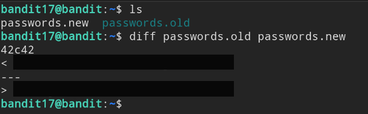

# Level 17 — Finding the changed password line

**Session:** `bandit17` → `bandit18` · [Official challenge](https://overthewire.org/wargames/bandit/bandit18.html)

## Level goal

From the [official challenge page](https://overthewire.org/wargames/bandit/bandit18.html):

> There are 2 files in the homedirectory: **passwords.old and passwords.new**. The password for the next level is in **passwords.new** and is the only line that has been changed between **passwords.old and passwords.new**
>
> **NOTE: if you have solved this level and see ‘Byebye!’ when trying to log into bandit18, this is related to the next level, bandit19**

## Commands I used

In the remote `bandit17` home directory:

```bash
ls
diff passwords.old passwords.new
```

| Command or output | Simple explanation |
| --- | --- |
| `ls` | Locate `passwords.old` and `passwords.new`. |
| `diff passwords.old passwords.new` | Compare the old file with the new file. |
| `42c42` | Line 42 in the old file changed to line 42 in the new file in this session. |
| `<` | Mark the line from `passwords.old`. |
| `>` | Mark the replacement line from `passwords.new`. |

Take the password on the `>` line, without the marker or its space. The `<` line is the old value.



## Backup

With GNU `diff`, print only added or replacement lines from the new file:

```bash
diff --old-line-format='' --unchanged-line-format='' --new-line-format='%L' passwords.old passwords.new
```

The first two formats suppress old and unchanged lines; `%L` prints the new line with its newline. `diff` returning status 1 means the files differ.

## Use case

Use `diff` to identify changes between versions of a text file, including configuration files and generated reports.

## Continue

Save the recovered password privately. Return to your local terminal using `exit`, `logout` in the SSH login shell, or `Ctrl+D` at an empty prompt. The official goal notes that `Byebye!` on a `bandit18` login is the next challenge's automatic logout; use the Level 18 remote-command approach if it appears. Then connect:

```bash
ssh -p 2220 bandit18@bandit.labs.overthewire.org
```

Enter the recovered password at the prompt. [Back to the index](../README.md)
