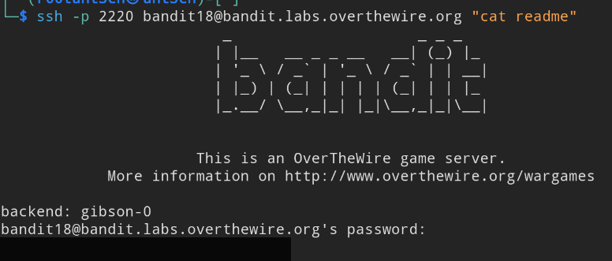

# Level 18 — Running an SSH command through the automatic logout

**Session:** `bandit18` → `bandit19` · [Official challenge](https://overthewire.org/wargames/bandit/bandit19.html)

## Level goal

From the [official challenge page](https://overthewire.org/wargames/bandit/bandit19.html):

> The password for the next level is stored in a file **readme** in the homedirectory. Unfortunately, someone has modified **.bashrc** to log you out when you log in with SSH.

## Commands I used

Run this from your local terminal:

```bash
ssh -p 2220 bandit18@bandit.labs.overthewire.org "cat readme"
```

| Part | Simple explanation |
| --- | --- |
| `ssh -p 2220` | Connect to Bandit's SSH port. |
| `bandit18@…` | Authenticate as `bandit18` with the password from Level 17. |
| `"cat readme"` | Request this remote command instead of an interactive login shell. |

The interactive login's `.bashrc` logs you out. Requesting the command directly lets it read `readme` and return the password for `bandit19`; SSH exits when the command finishes.



## Backup

For this one-password-per-line file:

```bash
ssh -T -p 2220 bandit18@bandit.labs.overthewire.org "head -n 1 readme"
```

`-T` disables pseudo-terminal allocation and `head -n 1` reads the first line. The remote command is the part that avoids the interactive logout.

## Use case

Use SSH remote commands to retrieve a file's contents or run a single task without opening an interactive shell.

## Continue

Save the recovered password privately. The SSH command above returns you to the local terminal. Then connect:

```bash
ssh -p 2220 bandit19@bandit.labs.overthewire.org
```

Enter the recovered password at the prompt. [Back to the index](../README.md)
