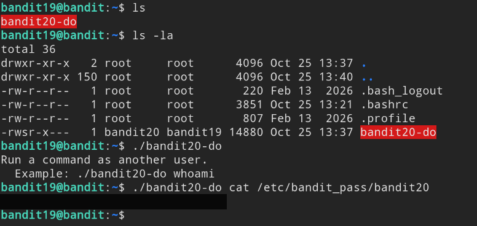

# Level 19 — Using the setuid command helper

**Session:** `bandit19` → `bandit20` · [Official challenge](https://overthewire.org/wargames/bandit/bandit20.html)

## Level goal

From the [official challenge page](https://overthewire.org/wargames/bandit/bandit20.html):

> To gain access to the next level, you should use the setuid binary in the homedirectory. Execute it without arguments to find out how to use it. The password for this level can be found in the usual place (/etc/bandit_pass), after you have used the setuid binary.

## Commands I used

In the remote `bandit19` home directory:

```bash
ls
ls -la
./bandit20-do
./bandit20-do cat /etc/bandit_pass/bandit20
```

| Command or part | Simple explanation |
| --- | --- |
| `ls` / `ls -la` | Locate the helper and show its owner and permissions. |
| `-rwsr-x---` | The owner execute position contains `s`: the executable has the setuid bit. |
| `./bandit20-do` | Run the local helper without arguments to read its usage. |
| `./bandit20-do cat …` | Ask the helper to run `cat` with the access needed to read the next password. |
| `/etc/bandit_pass/bandit20` | The password file for the helper's owner, `bandit20`. |

The helper is owned by `bandit20`. Its setuid execution provides that user's effective identity for the requested command.



## Backup

Use the same helper with another reader:

```bash
./bandit20-do head -n 1 /etc/bandit_pass/bandit20
```

`head` prints the first line of this one-password-per-line file while the helper supplies the required access.

## Use case

Setuid programs can expose a specific operation using the executable owner's access. This challenge demonstrates why the program's owner, permissions, and allowed command matter.

## Continue

Save the recovered password privately. Return to your local terminal using `exit`, `logout` in the SSH login shell, or `Ctrl+D` at an empty prompt. Then connect:

```bash
ssh -p 2220 bandit20@bandit.labs.overthewire.org
```

Enter the recovered password at the prompt. [Back to the index](../README.md)
