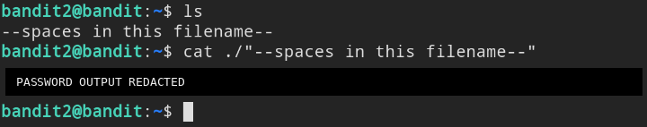

# Level 2 — Spaces and leading dashes

**Session:** `bandit2` → `bandit3` · [Official challenge](https://overthewire.org/wargames/bandit/bandit3.html)

Start in the remote `bandit2` home directory, using the password you recovered in Level 1.

## Commands I used

```bash
ls
cat ./"--spaces in this filename--"
```

| Command or part | Simple explanation |
| --- | --- |
| `ls` | List files to see the exact filename. |
| `cat` | Print the selected file's contents. |
| `./` | Start a relative path so the leading dashes are handled as part of a filename. |
| `"--spaces in this filename--"` | Keep the spaces inside one filename argument. |

The shell joins the unquoted `./` and quoted filename into one argument. `cat` opens that file and prints the password for `bandit3`.



## Backup

```bash
cat -- "--spaces in this filename--"
```

`--` ends option parsing for `cat`; the quotes keep the filename together. Quoting alone does not stop the leading dashes from being interpreted as an option.

Some older walkthroughs show `spaces in this filename`. Use the exact name shown by your own `ls` output; this session includes the dashes.

## Continue

Save the password privately. Return to your local terminal with any of these options, tested in a Bandit SSH login shell:

| Option | How to use it |
| --- | --- |
| `exit` | Type the command and press Enter to end the remote shell. |
| `logout` | Type the command and press Enter in the SSH login shell. |
| `Ctrl+D` | Press at an empty shell prompt to end the remote shell. |

Then connect from your local terminal:

```bash
ssh -p 2220 bandit3@bandit.labs.overthewire.org
```

Enter the recovered password at the prompt. [Back to the index](../README.md)
