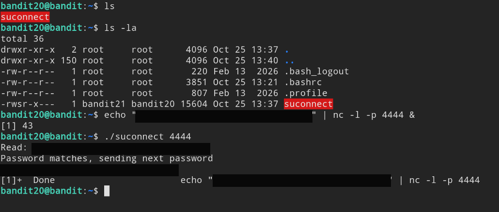

# Level 20 — Connecting a setuid client to a Netcat listener

**Session:** `bandit20` → `bandit21` · [Official challenge](https://overthewire.org/wargames/bandit/bandit21.html)

## Level goal

From the [official challenge page](https://overthewire.org/wargames/bandit/bandit21.html):

> There is a setuid binary in the homedirectory that does the following: it makes a connection to localhost on the port you specify as a commandline argument. It then reads a line of text from the connection and compares it to the password in the previous level (bandit20). If the password is correct, it will transmit the password for the next level (bandit21).
>
> **NOTE:** Try connecting to your own network daemon to see if it works as you think

## Commands I used

In the remote `bandit20` home directory:

```bash
ls
ls -la
echo "[current bandit20 password]" | nc -l -p 4444 &
./suconnect 4444
```

The bracketed text stands for the password recovered in Level 19; replace it privately with the actual value. The screenshot's real value is hidden everywhere it appears, including the job-completion line.

| Command or part | Simple explanation |
| --- | --- |
| `ls -la` | Show `suconnect`, owned by `bandit21` and marked setuid. |
| `echo "…"` | Supply the current password followed by a newline. |
| `\|` | Feed that line to Netcat. |
| `nc -l -p 4444` | Listen for a TCP connection on port 4444 with this Netcat version. |
| `&` | Run the listener pipeline in the background so the shell can start the client. |
| `./suconnect 4444` | Connect the setuid client to that listener on localhost. |

The listener sends the `bandit20` password. `suconnect` checks it and sends the `bandit21` password back; Netcat prints that reply. `Password matches, sending next password` confirms the exchange.

Both programs run on Bandit. Port 4444 is my chosen listener port; account logins use port 2220. Start the listener before the client, and give both the same port number.



## Backup

Use two SSH sessions logged in as `bandit20` on the same Bandit server.

In terminal A, start the listener:

```bash
nc -l -p 4444
```

In terminal B, connect the client:

```bash
./suconnect 4444
```

Return to terminal A, enter the current `bandit20` password, and press Enter. The reply containing the next password appears in terminal A. This keeps the listener in the foreground instead of using `&`.

## Use case

Use a Netcat listener to test a TCP client's request/response behavior. This challenge also demonstrates the different roles of a listening server and a connecting client.

## Continue

Save the recovered password privately. Return to your local terminal using `exit`, `logout` in the SSH login shell, or `Ctrl+D` at an empty prompt. Then connect:

```bash
ssh -p 2220 bandit21@bandit.labs.overthewire.org
```

Enter the recovered password at the prompt. [Back to the index](../README.md)
