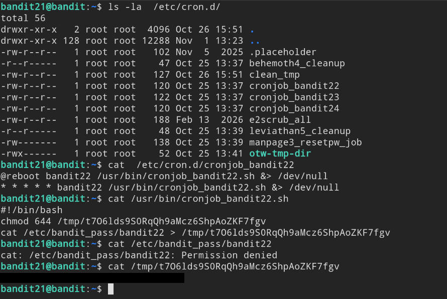

# Level 21 — Following a cron job to its output file

**Session:** `bandit21` → `bandit22` · [Official challenge](https://overthewire.org/wargames/bandit/bandit22.html)

## Level goal

From the [official challenge page](https://overthewire.org/wargames/bandit/bandit22.html):

> A program is running automatically at regular intervals from **cron**, the time-based job scheduler. Look in **/etc/cron.d/** for the configuration and see what command is being executed.

## Commands I used

In the remote `bandit21` shell:

```bash
ls -la /etc/cron.d/
cat /etc/cron.d/cronjob_bandit22
cat /usr/bin/cronjob_bandit22.sh
cat /etc/bandit_pass/bandit22
cat /tmp/t7061ds9S0RqQh9aMcz6ShpAoZKF7fgv
```

The direct read of `/etc/bandit_pass/bandit22` fails with `Permission denied`. The cron job runs as `bandit22`, copies that password to a file under `/tmp`, and sets its permissions to `644`. Reading the copy succeeds.

| Command or part | Simple explanation |
| --- | --- |
| `ls -la /etc/cron.d/` | List the system cron configuration files, including their permissions. |
| `cat /etc/cron.d/cronjob_bandit22` | Find the scheduled command and the account that runs it. |
| `@reboot bandit22 …` | Run the command as `bandit22` when cron starts. |
| `* * * * * bandit22 …` | Run the command as `bandit22` every minute. |
| `&> /dev/null` | Bash syntax for discarding standard output and error. |
| `cat /usr/bin/cronjob_bandit22.sh` | Inspect what the scheduled script does. |
| `chmod 644 …` in the script | Give the owner read/write access and everyone else read access. |
| `cat … > …` in the script | Read the protected password and write it to the output file. |

| Result path part | Simple explanation |
| --- | --- |
| `/tmp/` | The temporary-file directory on the Bandit server. |
| `t7061ds9S0RqQh9aMcz6ShpAoZKF7fgv` | The output filename shown in this session's script; it is not the password. |
| `cat /tmp/…` | Read the accessible copy. Use the path in your own script if it differs. |



## Backup

Read the first line of the same output file:

```bash
head -n 1 /tmp/t7061ds9S0RqQh9aMcz6ShpAoZKF7fgv
```

`head -n 1` prints the first line of this one-password-per-line file. This reader was checked with harmless local text; the screenshot records the Bandit solution using `cat`.

## Use case

Follow a scheduled job from its configuration to its script and output when troubleshooting automated tasks. This level shows how readable output can expose data that the source file protects.

## Continue

SSH carries the account logins; the cron commands above run locally on the Bandit server. Save the recovered password privately, then return to your local terminal with `exit`, `logout`, or `Ctrl+D` at an empty prompt:

```bash
ssh -p 2220 bandit22@bandit.labs.overthewire.org
```

| Part | Simple explanation |
| --- | --- |
| `ssh -p 2220` | Connect to Bandit's SSH port. |
| `bandit22@bandit.labs.overthewire.org` | Select the next account on the Bandit server. |

Enter the recovered password at the prompt. [Back to the index](../README.md)
