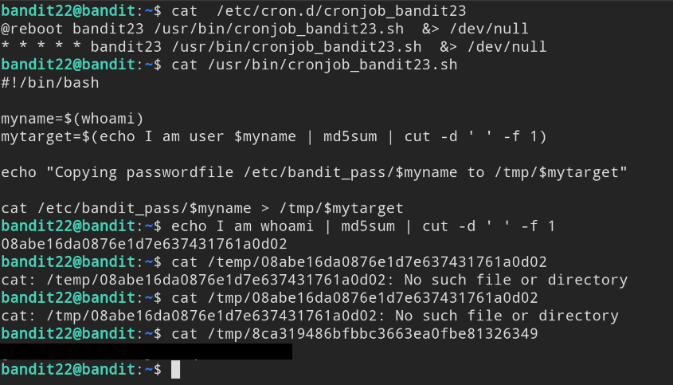

# Level 22 — Reproducing a cron script's hashed filename

**Session:** `bandit22` → `bandit23` · [Official challenge](https://overthewire.org/wargames/bandit/bandit23.html)

## Level goal

From the [official challenge page](https://overthewire.org/wargames/bandit/bandit23.html):

> A program is running automatically at regular intervals from **cron**, the time-based job scheduler. Look in **/etc/cron.d/** for the configuration and see what command is being executed.
>
> **NOTE:** Looking at shell scripts written by other people is a very useful skill. The script for this level is intentionally made easy to read. If you are having problems understanding what it does, try executing it to see the debug information it prints.

## Commands I used

In the remote `bandit22` shell, inspect the job and its script:

```bash
cat /etc/cron.d/cronjob_bandit23
cat /usr/bin/cronjob_bandit23.sh
```

The cron configuration runs the script as `bandit23` at startup and every minute. Inside that run, `myname=$(whoami)` becomes `bandit23`. The script hashes the line `I am user bandit23`, including its newline, and copies the password to `/tmp/$mytarget`.

The screenshot includes these unsuccessful attempts:

```bash
echo I am whoami | md5sum | cut -d ' ' -f 1
cat /temp/08abe16da0876e1d7e637431761a0d02
cat /tmp/08abe16da0876e1d7e637431761a0d02
```

That `echo` hashes the literal words `I am whoami`; it does not execute `whoami`, and it omits `user`. The first read also uses `/temp` instead of the script's `/tmp`. Correcting the directory alone still leaves the wrong hash.

The successful calculation is missing from the capture. I confirmed that I used the following command before reading the correct file:

```bash
echo I am user bandit23 | md5sum | cut -d ' ' -f 1
cat /tmp/8ca319486bfbbc3663ea0fbe81326349
```

| Command or part | Simple explanation |
| --- | --- |
| `cat /etc/cron.d/cronjob_bandit23` | Find the scheduled command and its `bandit23` account. |
| `cat /usr/bin/cronjob_bandit23.sh` | Read the filename calculation and password-copy operation. |
| `$(whoami)` in the script | Substitute the executing account's name; cron runs it as `bandit23`. |
| `echo I am user bandit23` | Reproduce the script's exact input, including the newline. |
| `\| md5sum` | Calculate the MD5 digest of that input. |
| `cut -d ' ' -f 1` | Keep the first space-delimited field: the digest. |
| `/tmp/8ca319486bfbbc3663ea0fbe81326349` | Combine the server's temporary directory with the calculated output filename. |
| `cat /tmp/…` | Read the password copy written by the scheduled job. |

Running `whoami` in my current shell would return `bandit22`. The filename must use the job's account, `bandit23`; the digest identifies a path and is not the password.



## Backup

Use `printf` for the same newline-terminated input and `awk` to select the digest:

```bash
target=$(printf 'I am user %s\n' bandit23 | md5sum | awk '{print $1}')
head -n 1 "/tmp/$target"
```

This requires `md5sum` and `awk`. The calculation and first-line reader were checked with harmless local data; the recorded Bandit session used `echo`, `cut`, and `cat`.

## Use case

Reproduce a script's exact inputs to locate generated files. A deterministic hashed filename can be calculated by anyone who can read the script.

## Continue

SSH carries the login; the scheduled job and `/tmp` path are on the Bandit server. Save the recovered password privately and return to your local terminal with `exit`, `logout`, or `Ctrl+D` at an empty prompt:

```bash
ssh -p 2220 bandit23@bandit.labs.overthewire.org
```

| Part | Simple explanation |
| --- | --- |
| `ssh -p 2220` | Connect to Bandit's SSH port. |
| `bandit23@bandit.labs.overthewire.org` | Select the next account on the Bandit server. |

Enter the recovered password at the prompt. [Back to the index](../README.md)
