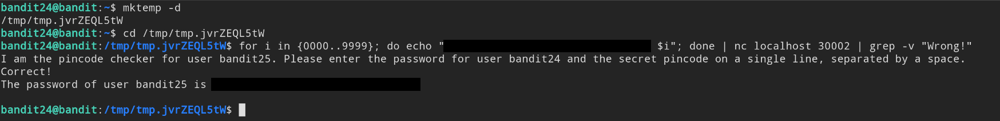

# Level 24 — Sending every four-digit PIN over one TCP connection

**Session:** `bandit24` → `bandit25` · [Official challenge](https://overthewire.org/wargames/bandit/bandit25.html)

## Level goal

From the [official challenge page](https://overthewire.org/wargames/bandit/bandit25.html):

> A daemon is listening on port 30002 and will give you the password for bandit25 if given the password for bandit24 and a secret numeric 4-digit pincode. There is no way to retrieve the pincode except by going through all of the 10000 combinations, called brute-forcing.
> You do not need to create new connections each time

## Commands I used

In the remote `bandit24` shell:

```bash
mktemp -d
cd /tmp/tmp.jvrZEQL5tW
for i in {0000..9999}; do echo "[current bandit24 password] $i"; done | nc localhost 30002 | grep -v "Wrong!"
```

The `cd` path is the directory returned by `mktemp -d` in this session; use your own generated path. The loop streams its input and does not need a file in that directory. Replace the bracketed placeholder privately with the password recovered in Level 23.

| Command or part | Simple explanation |
| --- | --- |
| `mktemp -d` / `cd …` | Create and enter a temporary working directory, as shown in the capture. |
| `for i in {0000..9999}` | With Bash's padded brace expansion, try all 10,000 PINs from `0000` through `9999`. |
| `echo "… $i"` | Send the current password, one space, and the PIN as a newline-terminated line. |
| `done \| nc localhost 30002` | Feed the whole loop to one Netcat client and one TCP connection. |
| `localhost` | Connect to the Bandit server because the command runs in its remote shell. |
| `30002` | The challenge daemon's TCP port. |
| `grep -v "Wrong!"` | Hide replies containing `Wrong!`, keeping the banner, success message, and returned password. |

Keep `nc` after `done` so the loop uses a single connection. The service accepts one password/PIN pair per line, returns `Correct!` for a match, and prints the password for `bandit25`. The screenshot hides both the submitted password inside the command and the returned password.



## Backup

Read the current password from its file and generate the PINs with `seq`:

```bash
current_password=$(cat /etc/bandit_pass/bandit24)
seq -w 0 9999 |
  while IFS= read -r pin; do
    printf '%s %s\n' "$current_password" "$pin"
  done |
  nc localhost 30002 |
  grep -v 'Wrong!'
```

This uses GNU `seq -w` to pad each number to four digits. `IFS= read -r` reads each generated PIN unchanged, and `printf` writes the required line format. Netcat's client form `nc host port` works with the traditional and OpenBSD variants. If the client remains open after the result, press `Ctrl+C` to return to the shell.

Both PIN generators and the response filter were checked against a harmless local TCP fixture using dummy data, including all 10,000 combinations and one connection per run. Those checks did not contact Bandit; the screenshot records the actual challenge result.

## Use case

Generate a bounded set of inputs and stream them through one connection when testing a line-based service in an authorized lab. Preserve leading zeroes when the protocol requires a fixed-width number.

## Continue

Port `30002` is the challenge service; account logins use SSH port `2220`. Save the recovered password privately, then return to your local terminal with `exit`, `logout`, or `Ctrl+D` at an empty prompt:

```bash
ssh -p 2220 bandit25@bandit.labs.overthewire.org
```

| Part | Simple explanation |
| --- | --- |
| `ssh -p 2220` | Connect to Bandit's SSH port. |
| `bandit25@bandit.labs.overthewire.org` | Select the next account on the Bandit server. |

Enter the recovered password at the prompt. [Back to the index](../README.md)
