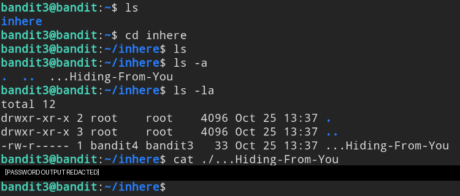

# Level 3 — Hidden files

**Session:** `bandit3` → `bandit4` · [Official challenge](https://overthewire.org/wargames/bandit/bandit4.html)

## Level goal

From the [official challenge page](https://overthewire.org/wargames/bandit/bandit4.html):

> The password for the next level is stored in a hidden file in the **inhere** directory.

## Commands I used

In the remote `bandit3` home directory:

```bash
ls
cd inhere
ls
ls -a
ls -la
cat ./...Hiding-From-You
```

| Command | Simple explanation |
| --- | --- |
| `ls` | List visible entries in the current directory. |
| `cd inhere` | Move into the directory containing the hidden file. |
| `ls -a` | Include names starting with a dot, including `...Hiding-From-You`. |
| `ls -la` | Include hidden entries and show permissions, ownership, and size. |
| `cat ./...Hiding-From-You` | Read the hidden file in the current directory. |

The second plain `ls` appears empty because it leaves out hidden names. `.` and `..` in `ls -a` refer to the current and parent directories; `...Hiding-From-You` is a separate file. Use its exact spelling from your session.



## Backup

```bash
cat < ./...Hiding-From-You
```

From `inhere`, the shell opens the same file as standard input and `cat` prints it.

## Continue

Save the recovered password privately. Return to your local terminal using `exit`, `logout` in the SSH login shell, or `Ctrl+D` at an empty prompt. Then connect:

```bash
ssh -p 2220 bandit4@bandit.labs.overthewire.org
```

Enter the recovered password at the prompt. [Back to the index](../README.md)
