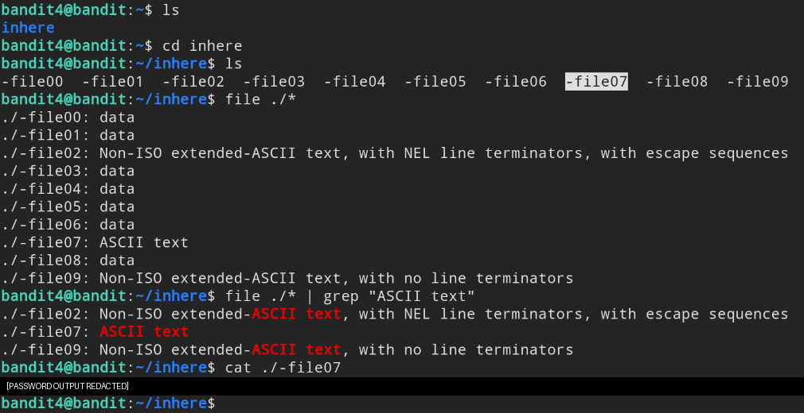

# Level 4 — Finding the readable file

**Session:** `bandit4` → `bandit5` · [Official challenge](https://overthewire.org/wargames/bandit/bandit5.html)

## Commands I used

In the remote `bandit4` home directory:

```bash
ls
cd inhere
ls
file ./*
file ./* | grep "ASCII text"
cat ./-file07
```

| Command or part | Simple explanation |
| --- | --- |
| `ls` | List entries before and after entering `inhere`. |
| `cd inhere` | Move into the directory containing the candidate files. |
| `file ./*` | Describe each visible entry; `./` keeps dash-prefixed filenames from looking like options. |
| `\|` | Send those descriptions to the next command. |
| `grep "ASCII text"` | Keep descriptions containing this substring. |
| `cat ./-file07` | Read the file identified as plain `ASCII text` in this session. |

The filter also matches `Non-ISO extended-ASCII text`, so it returns three candidates here. The full descriptions identify `./-file07: ASCII text` as the plain-text file. Inspect the descriptions before reading a candidate; printing binary data can disrupt the terminal.

The colon in `file` output separates the path from its description. Leave it out of the `cat` command.



## Backup

```bash
cat < ./-file07
```

After identifying the readable file in `inhere`, input redirection reads that same file without treating its leading dash as an option.

## Continue

Save the recovered password privately. Return to your local terminal using `exit`, `logout` in the SSH login shell, or `Ctrl+D` at an empty prompt. Then connect:

```bash
ssh -p 2220 bandit5@bandit.labs.overthewire.org
```

Enter the recovered password at the prompt. [Back to the index](../README.md)
