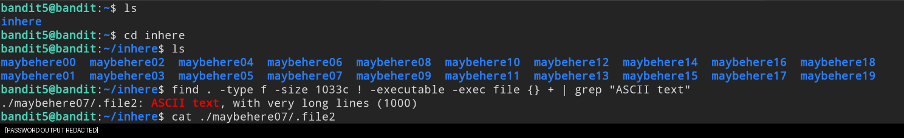

# Level 5 — Searching by size and permissions

**Session:** `bandit5` → `bandit6` · [Official challenge](https://overthewire.org/wargames/bandit/bandit6.html)

## Commands I used

In the remote `bandit5` home directory:

```bash
ls
cd inhere
ls
find . -type f -size 1033c ! -executable -exec file {} + | grep "ASCII text"
cat ./maybehere07/.file2
```

| Command or part | Simple explanation |
| --- | --- |
| `ls` | List the home directory, then the candidate subdirectories. |
| `cd inhere` | Enter the directory to search. |
| `find .` | Search here and in subdirectories, including hidden entries. |
| `-type f` | Select regular files. |
| `-size 1033c` | Select files exactly 1033 bytes long; `c` means bytes. |
| `! -executable` | Exclude files the current user can execute. |
| `-exec file {} +` | Describe matches in batches; `{}` holds their paths and `+` ends the action. |
| `\|` | Send the descriptions to the next command. |
| `grep "ASCII text"` | Keep descriptions containing `ASCII text`; inspect the complete description. |
| `cat ./maybehere07/.file2` | Read the matching file found in this session. |

All `find` conditions apply together. The remaining description is `ASCII text, with very long lines (1000)`. Its path includes the hidden filename `.file2`; copy the path before the colon, including the dot.



## Backup

```bash
cat < ./maybehere07/.file2
```

From `inhere`, this reads the file already identified by the search through standard input. Use the path returned in your own session if it differs.

## Continue

Save the recovered password privately. Return to your local terminal using `exit`, `logout` in the SSH login shell, or `Ctrl+D` at an empty prompt. Then connect:

```bash
ssh -p 2220 bandit6@bandit.labs.overthewire.org
```

Enter the recovered password at the prompt. [Back to the index](../README.md)
