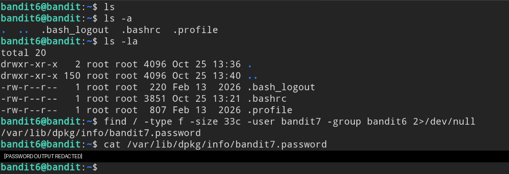

# Level 6 — Searching by owner and group

**Session:** `bandit6` → `bandit7` · [Official challenge](https://overthewire.org/wargames/bandit/bandit7.html)

## Commands I used

In the remote `bandit6` home directory:

```bash
ls
ls -a
ls -la
find / -type f -size 33c -user bandit7 -group bandit6 2>/dev/null
cat /var/lib/dpkg/info/bandit7.password
```

| Command or part | Simple explanation |
| --- | --- |
| `ls` | List visible entries in the home directory. |
| `ls -a` | Include hidden entries. |
| `ls -la` | Also show permissions, owner, group, and size. |
| `find /` | Search from the filesystem root because the file is elsewhere on the server. |
| `-type f` | Select regular files. |
| `-size 33c` | Select files exactly 33 bytes long. |
| `-user bandit7` | Require `bandit7` as the file owner. |
| `-group bandit6` | Require `bandit6` as the owning group. |
| `2>/dev/null` | Discard standard error, including permission-denied messages; matching paths remain on standard output. |

The conditions select the file matching the challenge's size and ownership. Hiding errors does not grant access to restricted directories; omit the redirection if you need to inspect those errors. Run this search on Bandit, where the named accounts exist.

| Result path or command | Simple explanation |
| --- | --- |
| `/` | Begin at the filesystem root. |
| `var/lib/` | Application state data. |
| `dpkg/info/` | Debian package metadata, where this session's match was found. |
| `bandit7.password` | The matching filename. |
| `cat /var/lib/dpkg/info/bandit7.password` | Print the file's contents. |



## Backup

```bash
find / -type f -size 33c -user bandit7 -group bandit6 -exec cat {} + 2>/dev/null
```

`-exec cat {} +` reads the matching files directly in batches, replacing the separate path-copying and `cat` step. The other conditions and error redirection are the same.

## Continue

Save the recovered password privately. Return to your local terminal using `exit`, `logout` in the SSH login shell, or `Ctrl+D` at an empty prompt. Then connect:

```bash
ssh -p 2220 bandit7@bandit.labs.overthewire.org
```

Enter the recovered password at the prompt. [Back to the index](../README.md)
