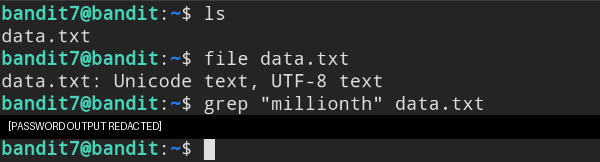

# Level 7 — Finding the millionth entry

**Session:** `bandit7` → `bandit8` · [Official challenge](https://overthewire.org/wargames/bandit/bandit8.html)

## Level goal

From the [official challenge page](https://overthewire.org/wargames/bandit/bandit8.html):

> The password for the next level is stored in the file **data.txt** next to the word **millionth**

## Commands I used

In the remote `bandit7` home directory:

```bash
ls
file data.txt
grep "millionth" data.txt
```

| Command | Simple explanation |
| --- | --- |
| `ls` | Locate `data.txt` in the home directory. |
| `file data.txt` | Identify the file as UTF-8 text in this session. |
| `grep "millionth" data.txt` | Print lines containing `millionth`. |

The matching line pairs the word with the password for `bandit8`. Save only the password from that line in private notes. `grep` searches for a matching substring, so the backup below is useful when you want to match the first column exactly.



## Backup

```bash
awk '$1 == "millionth" { print $2 }' data.txt
```

`awk` splits each line on whitespace. `$1` is the first field; when it equals `millionth`, `print $2` prints the second field, the password in this file's word-and-password format.

## Continue

Save the recovered password privately. Return to your local terminal using `exit`, `logout` in the SSH login shell, or `Ctrl+D` at an empty prompt. Then connect:

```bash
ssh -p 2220 bandit8@bandit.labs.overthewire.org
```

Enter the recovered password at the prompt. [Back to the index](../README.md)
