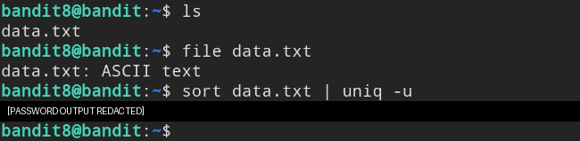

# Level 8 — Finding the line that occurs once

**Session:** `bandit8` → `bandit9` · [Official challenge](https://overthewire.org/wargames/bandit/bandit9.html)

## Level goal

From the [official challenge page](https://overthewire.org/wargames/bandit/bandit9.html):

> The password for the next level is stored in the file **data.txt** and is the only line of text that occurs only once

## Commands I used

In the remote `bandit8` home directory:

```bash
ls
file data.txt
sort data.txt | uniq -u
```

| Command or part | Simple explanation |
| --- | --- |
| `ls` | Locate `data.txt` in the home directory. |
| `file data.txt` | Identify the file as ASCII text in this session. |
| `sort data.txt` | Put identical lines next to each other. |
| `\|` | Send the sorted lines to `uniq`. |
| `uniq -u` | Print only groups containing one line. |

`uniq` compares adjacent lines, so sorting first is essential when duplicates are scattered through the file. `sort -u` keeps one copy of every distinct line, including repeated ones; it does not isolate the line that occurs only once.

The single remaining line is the password for `bandit9`.



## Backup

```bash
sort data.txt | uniq -c | awk '$1 == 1 { print $2 }'
```

`uniq -c` prefixes each group with its occurrence count. `awk` keeps a count of `1` and prints the password in the second field. This backup uses Bandit's one-password-per-line format, with no whitespace inside the password.

## Continue

Save the recovered password privately. Return to your local terminal using `exit`, `logout` in the SSH login shell, or `Ctrl+D` at an empty prompt. Then connect:

```bash
ssh -p 2220 bandit9@bandit.labs.overthewire.org
```

Enter the recovered password at the prompt. [Back to the index](../README.md)
