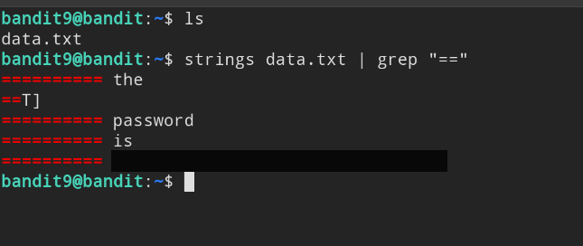

# Level 9 — Finding readable strings in a binary file

**Session:** `bandit9` → `bandit10` · [Official challenge](https://overthewire.org/wargames/bandit/bandit10.html)

## Level goal

From the [official challenge page](https://overthewire.org/wargames/bandit/bandit10.html):

> The password for the next level is stored in the file **data.txt** in one of the few human-readable strings, preceded by several ‘=’ characters.

## Commands I used

In the remote `bandit9` home directory:

```bash
ls
strings data.txt | grep "=="
```

| Command or part | Simple explanation |
| --- | --- |
| `ls` | Locate `data.txt`. |
| `strings data.txt` | Extract runs of printable characters from the file. |
| `\|` | Send those strings to the filter. |
| `grep "=="` | Keep strings containing two consecutive equals signs. |

The output includes the words “the password is” and a final string containing the password. Save the password after the equals signs, without the prefix. `strings` avoids printing the binary contents directly.



## Backup

```bash
strings data.txt | sed -n '/==/p'
```

`sed -n` suppresses ordinary output; `/==/p` prints strings with the same marker. Read the password-bearing result.

## Use case

Use `strings` to inspect readable messages inside binary files, then filter for a known marker.

## Continue

Save the recovered password privately. Return to your local terminal using `exit`, `logout` in the SSH login shell, or `Ctrl+D` at an empty prompt. Then connect:

```bash
ssh -p 2220 bandit10@bandit.labs.overthewire.org
```

Enter the recovered password at the prompt. [Back to the index](../README.md)
